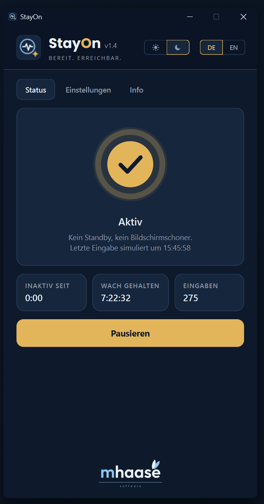

  

<h1 align="center">StayOn</h1>

  <strong>PC wach halten, Teams und Slack auf «Verfügbar».</strong> · <em>Keep your PC awake and Teams “Available”.</em> 
  Gratis für Windows · Deutsch und Englisch · Version 1.4 · von <a href="https://mhaase.ch">mhaase software</a>

  <a href="https://github.com/mhaase-software/StayOn/releases/latest"><strong>⬇ Download</strong></a> ·
  <a href="https://mhaase.ch">mhaase software</a>

---

StayOn verhindert, dass dein PC oder Laptop einschläft, und hält den Bildschirm an. Teams, Slack, Zoom und WebEx zeigen dich weiter als verfügbar, auch wenn du eine Weile nicht tippst. Auf Wunsch nur zu den Zeiten, die du festlegst.

  

## Funktionen

- **Standby verhindern** – PC und Laptop schlafen nicht ein.
- **Bildschirm wach halten** – kein Bildschirmschoner, kein Abdunkeln.
- **Teams und Slack aktiv halten** – unsichtbarer Tastendruck (F15) nach einstellbar vielen Sekunden ohne Eingabe. Wirkt auch für Zoom und WebEx.
- **Zeitplan** – z. B. Mo–Fr 08:00–17:00, auch über Mitternacht.
- **Infobereich** – läuft unten rechts weiter, wenn du das Fenster schliesst.
- **Mit Windows starten**, **Deutsch und Englisch**, **hell und dunkel**.

**Was ist F15?** Eine Funktionstaste, die es auf normalen Tastaturen nicht gibt. Programme reagieren nicht darauf, sie schreibt also nirgends etwas hinein.

## Download und Installation

Unter [**Releases**](https://github.com/mhaase-software/StayOn/releases/latest):

- **StayOn-Setup-1.4.exe** – empfohlen, mit Startmenü-Eintrag, fragt nach der Sprache
- **StayOn-1.4-Portable.zip** – ohne Installation: entpacken und `StayOn.exe` starten
- **StayOn-1.4.msi** – für Verteilung per Gruppenrichtlinie oder Softwareverteilung

StayOn ist nicht digital signiert. Windows SmartScreen zeigt deshalb beim ersten Start eine Warnung: **Weitere Informationen → Trotzdem ausführen**. Die SHA-256-Prüfsummen stehen bei jedem Release.

**Systemvoraussetzungen:** Windows 10 oder 11 (64 Bit).

## Gut zu wissen

- Auf Geräten deines Arbeitgebers können Richtlinien das Vortäuschen von Aktivität untersagen. Kläre das vorher.
- Erzwingt eine Firmen-Richtlinie die Bildschirmsperre, hilft auch StayOn nicht.
- Laptop schläft beim Zuklappen? Energieoptionen → «Auswählen, was beim Zuklappen passieren soll» → **Nichts unternehmen**.
- StayOn arbeitet ganz auf deinem Computer und sendet keine Daten.

## Fragen und Kontakt

- Fehler gefunden oder eine Idee? [Issue eröffnen](https://github.com/mhaase-software/StayOn/issues) oder an kontakt@mhaase.ch schreiben.

---

StayOn ist Freeware. Der Quellcode ist nicht öffentlich.
Die Software wird ohne Gewähr zur Verfügung gestellt.

© 2026 [mhaase software](https://mhaase.ch) · Bereit. Erreichbar.
